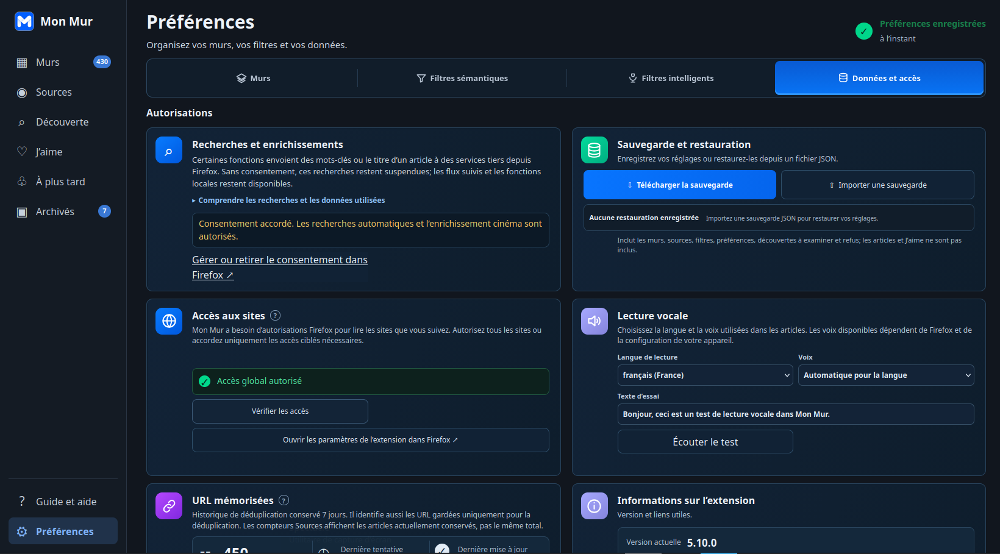
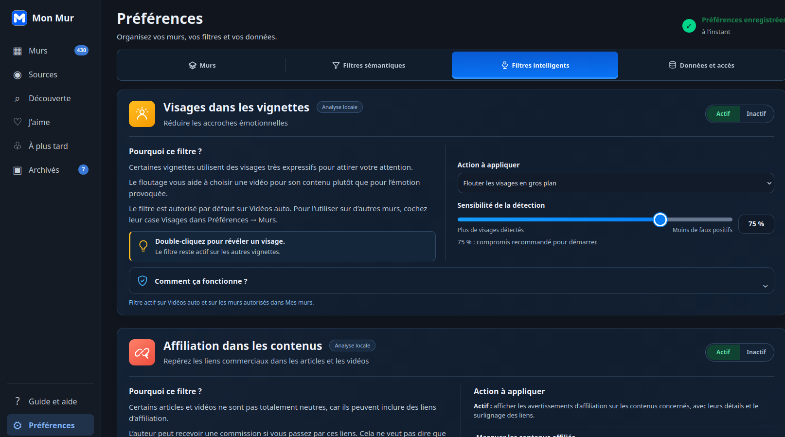
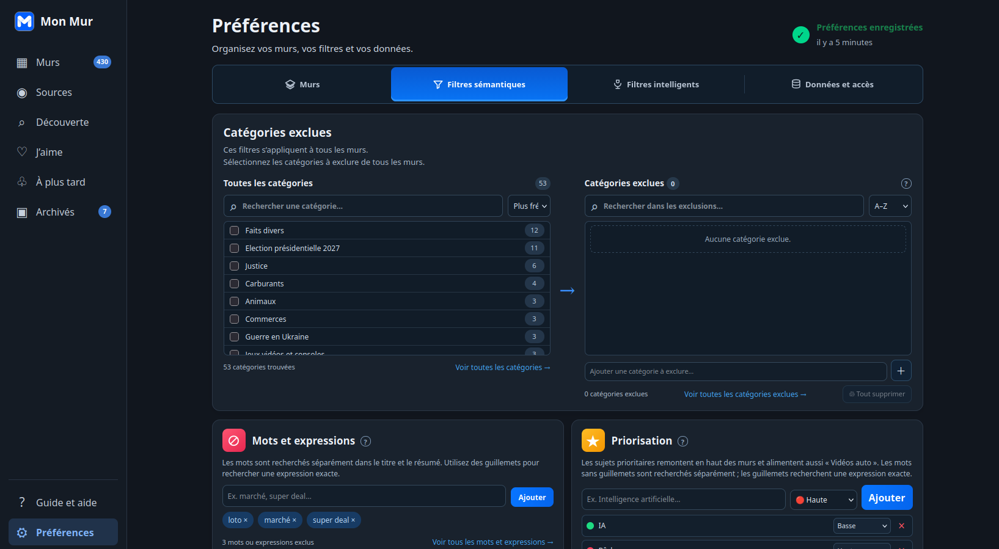
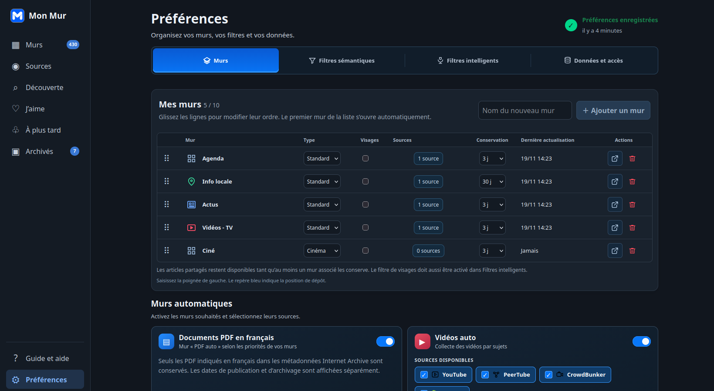
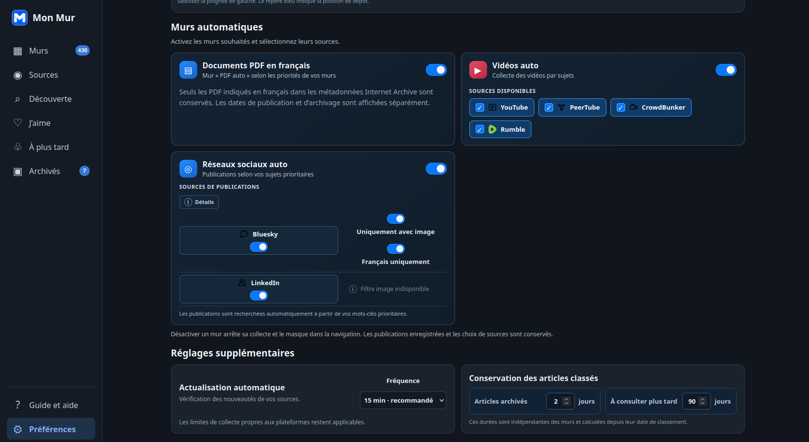
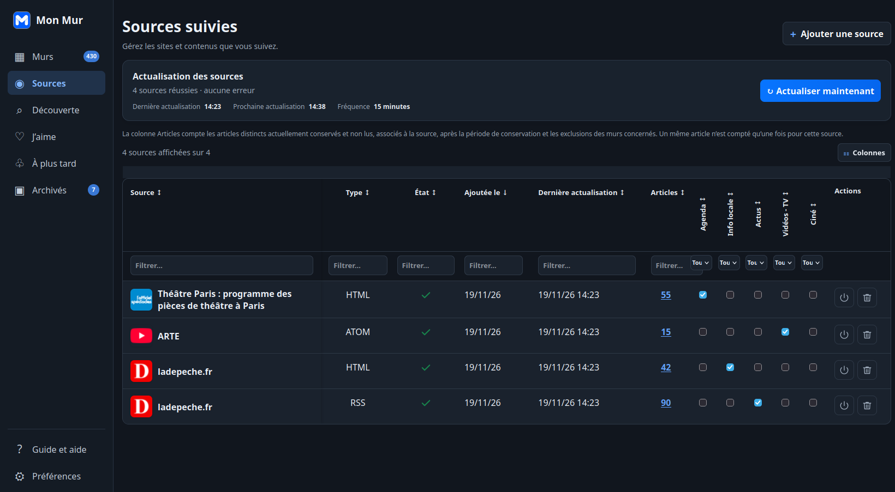
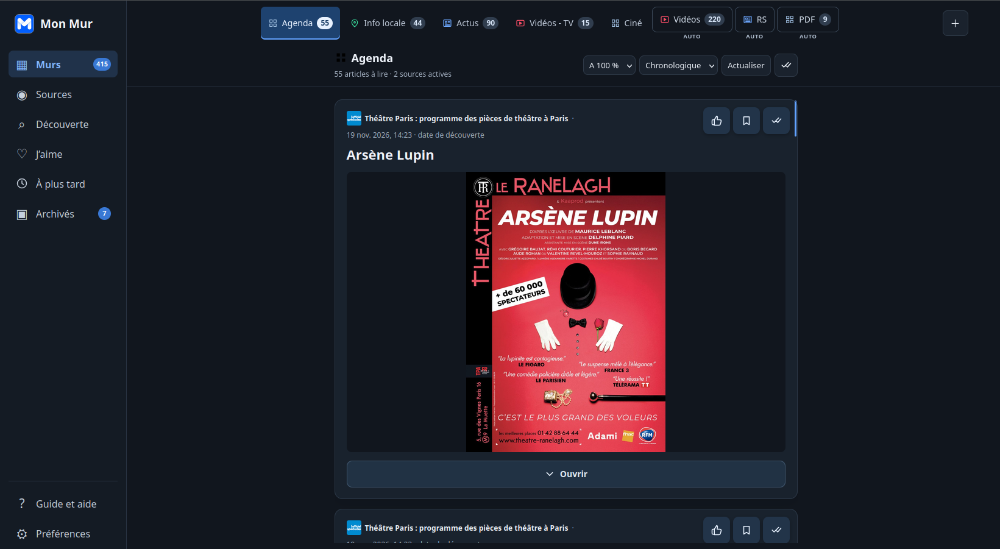
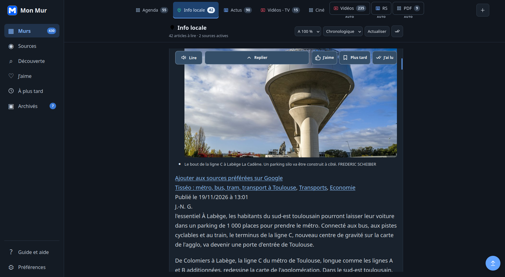
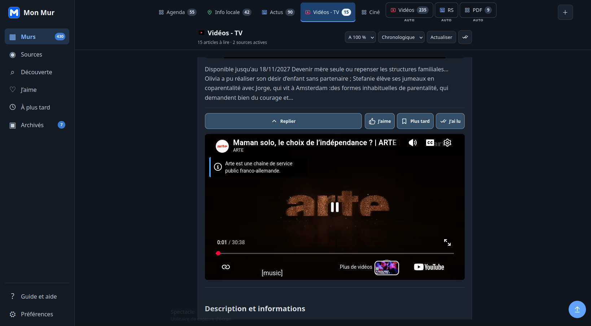

# Captures d’écran — Mon Mur 5.10.0

Ces captures officielles présentent les principaux écrans de Mon Mur 5.10.0. Cliquez sur une image pour l’ouvrir en taille réelle.

Les captures montrent des réglages, compteurs et contenus d’exemple issus d’un profil Firefox. Les marques, logos, photographies et contenus éditoriaux visibles restent la propriété de leurs ayants droit; ces captures servent uniquement à illustrer l’interface.

<table>
<tr><td width="50%">
<strong>Préférences — Données et accès</strong> <a href="preferences-donnees-et-acces-v5.10.0.png">Ouvrir l’image en taille réelle</a>
</td><td width="50%">
<strong>Préférences — Filtres intelligents</strong> <a href="preferences-filtres-intelligents-v5.10.0.png">Ouvrir l’image en taille réelle</a>
</td></tr>
<tr><td width="50%">
<strong>Préférences — Filtres sémantiques</strong> <a href="preferences-filtres-semantiques-v5.10.0.png">Ouvrir l’image en taille réelle</a>
</td><td width="50%">
<strong>Préférences — Mes murs</strong> <a href="preferences-mes-murs-v5.10.0.png">Ouvrir l’image en taille réelle</a>
</td></tr>
<tr><td width="50%">
<strong>Préférences — Murs automatiques et réseaux sociaux</strong> <a href="preferences-murs-automatiques-reseaux-sociaux-v5.10.0.png">Ouvrir l’image en taille réelle</a>
</td><td width="50%">
<strong>Sources suivies — actualisation</strong> <a href="sources-suivies-actualisation-v5.10.0.png">Ouvrir l’image en taille réelle</a>
</td></tr>
<tr><td width="50%">
<strong>Mur — carte d’article Arsène Lupin</strong> <a href="mur-agenda-carte-article-arsene-lupin-v5.10.0.png">Ouvrir l’image en taille réelle</a>
</td><td width="50%">
<strong>Mur — article local avec image et texte</strong> <a href="mur-info-locale-lecture-article-v5.10.0.png">Ouvrir l’image en taille réelle</a>
</td></tr>
<tr><td width="50%">
<strong>Mur — lecture vidéo intégrée</strong> <a href="mur-videos-tv-lecture-integree-v5.10.0.png">Ouvrir l’image en taille réelle</a>
</td><td width="50%"></td></tr>
</table>
